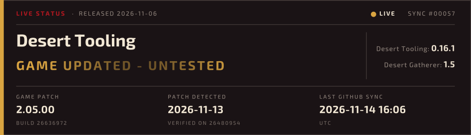

# baise badges

Generated by [baise](https://github.com/KiefBC/baise). This branch is rewritten by the workflow on every run; do not commit to it.

## Desert Tooling (`desert-tooling`)

Nexus Mods description (BBCode):

```
[img]https://raw.githubusercontent.com/KiefBC/desert-modding/badges/desert-tooling.gif[/img]
```

Markdown card:

```

```

Markdown badge (shields.io):

```

```

Still image: https://raw.githubusercontent.com/KiefBC/desert-modding/badges/desert-tooling.png

